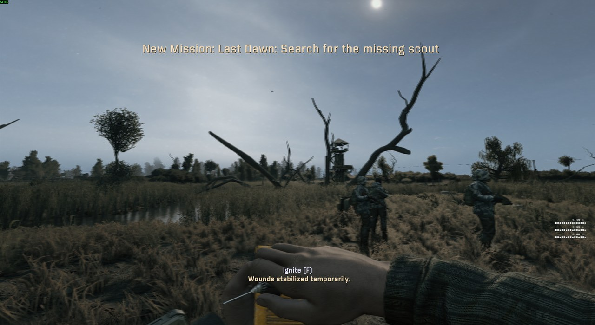

# Unholy's Wounded NPC Rescue Mod

An otherwise lethal body shot can leave an eligible human NPC alive and wounded. Approach them and use the existing medkit dialogue. Head and neck hits keep their usual damage behavior. The NPC's own wound settings decide whether help is available, so scripted and quest-specific wound behavior still applies.



The Marshes in Romeo, captured during the native test session that checked rescue eligibility and medkit transfer.

[Downloads and release notes](https://github.com/noahcabral/unholys-wounded-npc-rescue-mod/releases)

## Game versions

| Game | Setup | Verification |
| --- | --- | --- |
| Anomaly 1.5.3 | Install Monolith Modded Exes **2026.11.27** and the matching bundled gamedata, then install the Anomaly ZIP. | Engine callback and standalone scripts checked. In-game testing pending. |
| GAMMA | Build the overlay from the active `G.A.M.M.A. Close Quarter Combat` copy of `grok_bo.script`. | The configured GAMMA profile's donor was checked. In-game testing pending. |
| Romeo | Build from the GAMMA damage script and Romeo's active `companion_dbno.script` if present. | The original Romeo preview passed the live NPC body and head eligibility checks and the native medkit transfer check. The repackaged overlay uses the same integration points. |

The Anomaly build requires the engine callback that exposes damage after armor and hit-location calculations. [Monolith Modded Exes 2026.11.27](https://github.com/themrdemonized/xray-monolith/releases/tag/2026.11.27)

This release affects non-player characters. Romeo player downing, player headshot behavior, party wipes and save reloading stay with the co-op runtime. Romeo host and guest synchronization for rescued NPCs still needs a co-op test.

## Installation

Install the matching add-on in MO2 below its dependencies. For a loose-file Anomaly installation, merge the archive's `gamedata` folder into the game directory. If you use GAMMA or Romeo, generate the overlay with Python 3.10 or newer using your installed scripts. In MO2's Data tab, use the files that win before this mod is enabled. The script builder verifies its expected code before making any changes.

```powershell
# Anomaly with the Monolith engine
python build.py "Unholys Wounded NPC Rescue Mod - Anomaly.zip"

# GAMMA
python build.py "Unholys Wounded NPC Rescue Mod - GAMMA.zip" --gbo "path\to\grok_bo.script"

# Romeo with Erandis's companion downing enabled
python build.py "Unholys Wounded NPC Rescue Mod - Romeo.zip" --gbo "path\to\grok_bo.script" --companion "path\to\companion_dbno.script"
```

Disable `Romeo - Wounded NPC Rescue Preview` when switching to this package. Rebuild the overlay when a donor script changes. If another enabled mod edits `grok_bo.script` or `companion_dbno.script`, the builder needs the correct winning version and will stop if its damage hooks differ from those it supports.

The overlay uses your installed GAMMA ballistics and Erandis companion scripts. Original addon source is included here.
