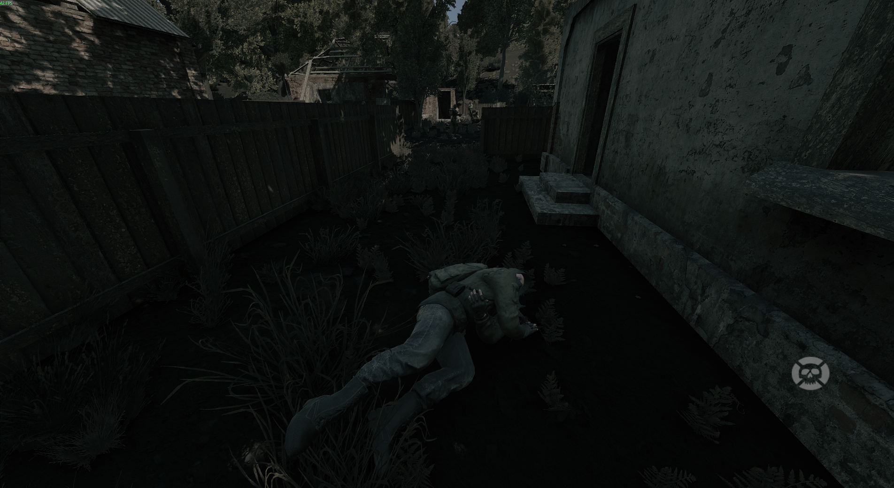
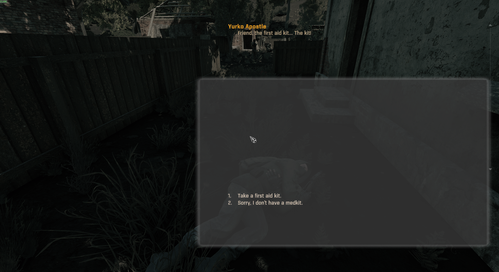

# Unholy's Wounded Character Rescue Mod

Treat eligible stalkers after a lethal body shot with the game's existing medkit dialogue. Headshots keep their usual damage behavior.

Available for Anomaly, GAMMA, and Romeo. Play in single-player or in Romeo co-op, where the host handles rescues.

*A wounded stalker in Romeo and the option to offer a first-aid kit.*
